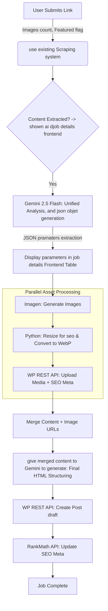
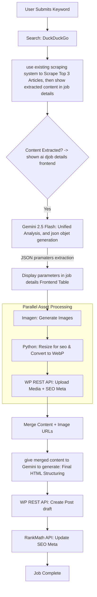

# DONE

# 🚀 Proposed Pipeline Improvements: Visual Explanation & Strategy

This document outlines the optimized workflows for the **Content Automation Engine**. It is designed as a technical specification for a coding LLM agent to implement using Python, FastAPI, and Celery.

---

## 🏗️ Core Strategy: The "Unified Analysis" Pattern

The primary optimization is moving from multiple sequential Gemini calls to a **Single-Shot Analysis**. We extract content once and ask Gemini to return a structured JSON schema containing everything needed for the next 5 steps.

### Workflow 1: Link to Article (Reference URL)


### Workflow 2: Keyword to Article


---

## 🛠️ Technical Implementation Details (For the Coding Agent)

### 1. The Unified Gemini Request
Instead of separate calls for title, outline, and tags, use a single system prompt that enforces a JSON schema.
*for image and image SEO meta data generation, the pipline mst generate what the user chose (how many images), the LLM json parameters extraction and prompt must be flexible (eg: when asked for 2 images, the LLM must generate 2 prompts and 2 image SEO data)

**Prompt Inspiration:**
> "Analyze this article and return a JSON object with: title, markdown_content, slug, focus_keyword, seo_title, seo_description, and an array of image_objects each containing prompt, title, alt_text, caption, and description."

### 2. Image Processing & WordPress Integration
Use the following logic (inspired by the n8n nodes) translated to Python `httpx` or `requests`:

*   **Image Generation:** Use Vertex AI Imagen via REST.
*   **Conversion:** Use `Pillow` in Python to convert to WebP and resize.
*   **WP Media API:** 
    *   Endpoint: `POST /wp-json/wp/v2/media`
    *   Header: `Content-Disposition: attachment; filename="image_title.webp"`
    *   Binary Body: The WebP file.
*   **RankMath Integration:**
    *   Endpoint: `POST /wp-json/rank-math-api/v1/update-meta/`
    *   Payload: `{"post_id": ID, "rank_math_focus_keyword": "...", ...}`

### 3. REST API Usage in Python
The agent should use `httpx` for async calls in the scraper and `requests` (or `httpx` with `asyncio.run`) in the Celery worker.

```python
# Example WP Media Upload
import httpx

async def upload_to_wp(image_data, metadata, wp_config):
    headers = {
        "Content-Disposition": f"attachment; filename=\"{metadata['filename']}\"",
        "Content-Type": "image/webp",
        "Authorization": f"Bearer {wp_config['token']}"
    }
    async with httpx.AsyncClient() as client:
        response = await client.post(f"{wp_config['url']}/wp-json/wp/v2/media", content=image_data, headers=headers)
        return response.json()
```

---

## 🎓 Mentor's Evaluation

### 🚀 Performance
- **Unified Call:** Reduces round-trip latency by ~60% compared to sequential calls.
- **WebP Conversion:** Smaller payloads to WordPress, faster page loads for the end user.
- **Async Scraping:** Crucial for the "Search Top 3" step to prevent blocking.

### 💰 Token Cost Optimization
- **Gemini 2.5 Flash:** Using Flash instead of Pro for the initial analysis is a significant cost saver with high performance for JSON extraction.
- **Context Reuse:** Passing the whole scraped content once instead of multiple times in different prompts saves input tokens.

### 👥 Multiuser & Scalability
- **Celery Concurrency:** Image generation is slow. Ensure `image_generation` tasks are sent to a dedicated high-concurrency queue to avoid blocking text-only jobs.
- **WP Rate Limits:** The pipeline should handle `429 Too Many Requests` from WordPress with exponential backoff.
- **Preview Step:** Showing the JSON in a table before final posting allows the user to "human-edit" the AI output, increasing SaaS value.

---

## 📑 n8n Node Reference (Legacy Logic)
*The original n8n node structures (JSON) are preserved below for reference on API endpoints and payload structures.*

<details>
<summary>View n8n JSON structures</summary>

[... original n8n JSON nodes content ...]

</details>