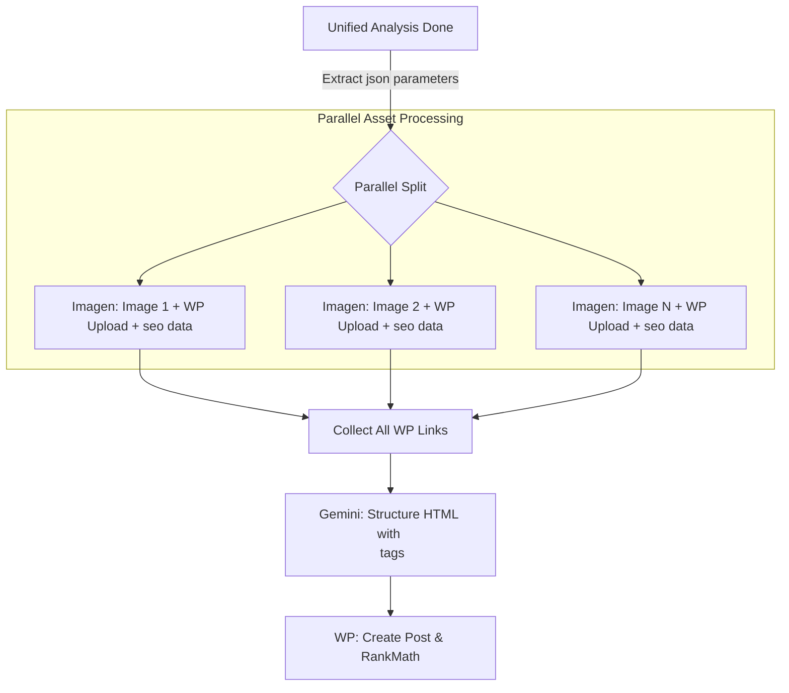
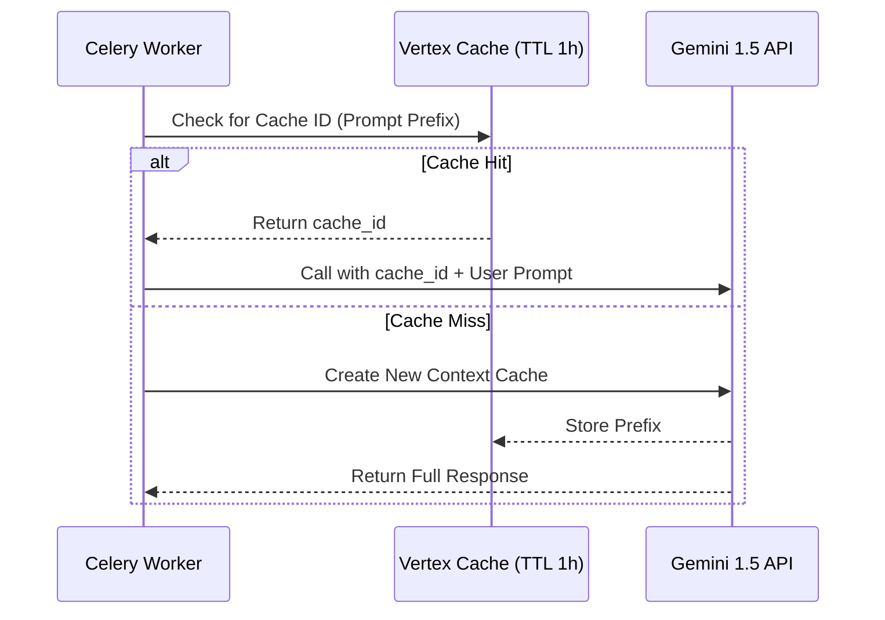
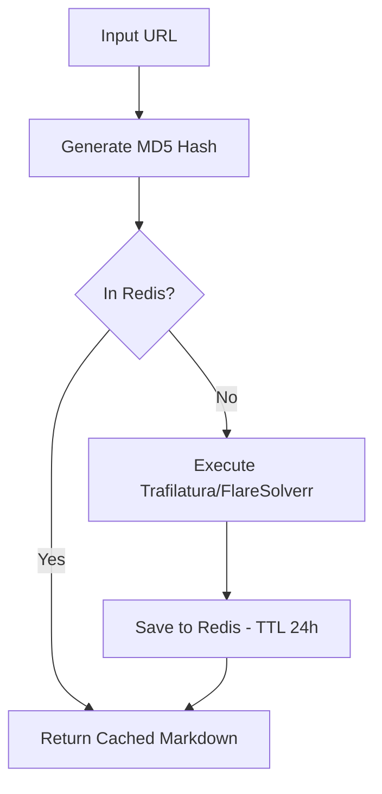
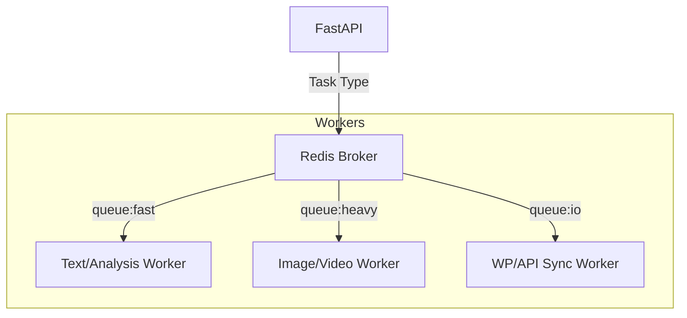

# DONE
# 🚀 Advanced Performance & Scalability Roadmap (Phase 2)

This document specifies high-impact optimizations for the **Content Automation Engine**. These features focus on reducing perceived latency, optimizing token costs, and ensuring multi-user stability.

---

## 🏗️ Feature 1: The "Parallel Asset Pipeline"
Instead of generating images one by one, we generate and upload all requested images (up to 5) simultaneously. This ensures the "Structure HTML" stage has all final WordPress image URLs before it begins.

### Visual Workflow

**Agent Note:** Use a Celery `group` to execute the image generation and WordPress uploads in parallel. The pipeline must wait for **all** images to return their WordPress URLs before calling Gemini for the final "Structure HTML" step. This ensures no broken images or placeholders in the final draft.

---

## 🧠 Feature 2: Vertex AI Context Caching
Reduce token costs and latency by caching long system prompts and search results.

### Visual Logic

**Agent Note:** Target the "Top 3 Scraped Articles" as the cache prefix. If multiple users generate content on similar topics, the input cost drops significantly.

---

## 🔍 Feature 3: Smart "Delta" Scraping Cache
Prevent redundant network requests and avoid IP bans by caching scraped content in Redis.

### Visual Logic

**Agent Note:** Use the existing Redis instance. Key format: `scrape:cache:<md5_hash>`.

---

## 🚥 Feature 4: Priority-Based Celery Queues
Ensure "fast" tasks (text) aren't stuck behind "heavy" tasks (images).

### Queue Architecture

**Agent Note:** Update `celery_app.py` to define `task_routes`. 
- `run_analysis` -> `fast`
- `generate_images` -> `heavy`
- `sync_to_wordpress` -> `io`

---

## 🎓 Mentor's Final Verdict for the Agent

1.  **Safety First:** When implementing the "Split-Join" (Feature 1), ensure that if the Image Branch fails, the Text Branch can still finish and notify the user with "Text ready, images failed."
2.  **Cost Monitoring:** For Vertex Caching (Feature 2), monitor the cache creation costs—only cache prefixes longer than 2048 tokens to ensure it's cost-effective.
