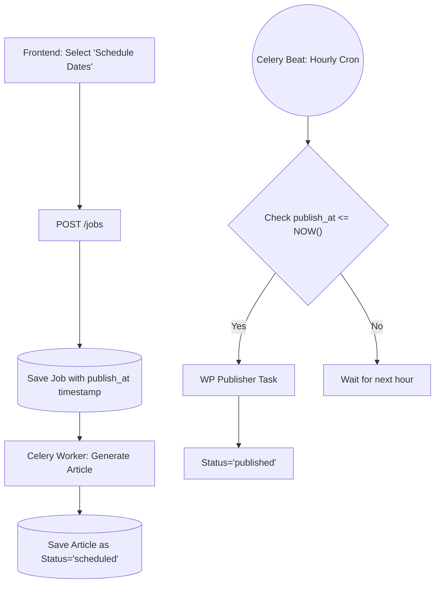
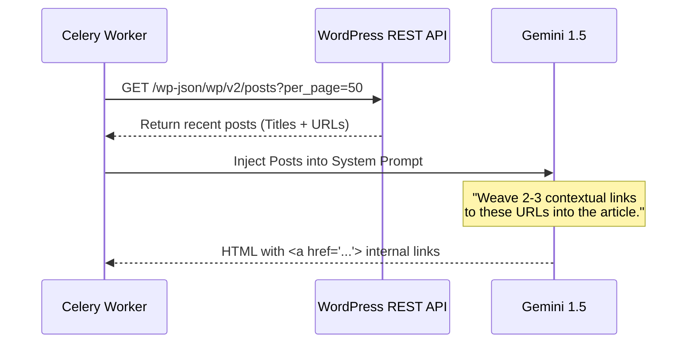
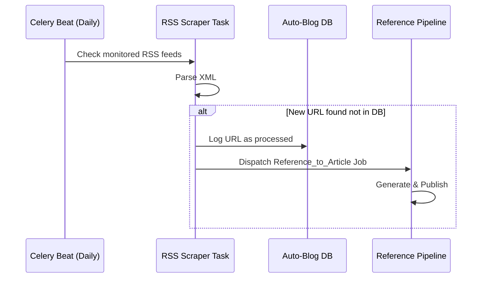
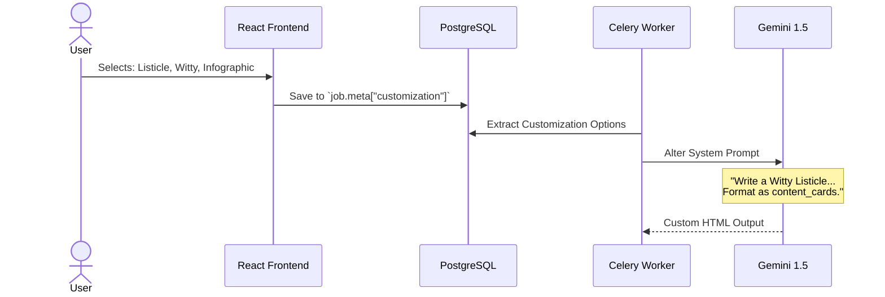

# 🚀 Auto-Blog SaaS: Advanced Feature Blueprint (Phase 3)

This document serves as the technical specification and architectural blueprint for the Coder LLM to implement the next major features for the Auto-Blog platform. It is broken down into three high-impact tiers.

---

## 🥇 Tier 1: SEO & Publishing Power
These features elevate the platform by fully automating the publishing lifecycle and maximizing SEO value through contextual linking.

### 1. Drip-Feed Scheduling
**Goal:** Allow users to generate a batch of articles today, but publish them slowly over time (e.g., 1 per day).

**Implementation Notes:**
- Add `publish_at` (DateTime) to `Article` model.
- Setup Celery Beat in `celery_app.py` with an hourly `crontab`.
- Create a new Celery task `publish_scheduled_articles` that queries the DB and runs `WordPressPublisher`.

### 2. Smart Internal Linking Engine
**Goal:** The AI should automatically weave links to the user's older WordPress posts into the new article.

---

## 🥈 Tier 2: Workflow Automation
Features designed to make the platform "sticky" by putting content generation on autopilot.

### 3. Auto-Pilot Competitor Monitoring
**Goal:** Automatically rewrite competitor content the moment they publish a new blog post via RSS.

### 4. Webhook / Zapier Integration
**Goal:** Allow external triggers (Airtable, Notion, Make.com) to start jobs.
**Implementation Notes:**
- Create a new endpoint `POST /api/v1/webhooks/trigger`.
- Secure it with a static API key tied to the User's account instead of JWT auth.
- The payload should mirror `JobCreate` schema.

---

## 🥉 Tier 3: Quality & Customization
Granular controls over the AI output to cater to high-end B2B users.

### 5. Granular Content Controls
**Goal:** Let users define the exact shape, structure, and tone of the output.

**The Customization Matrix (All fields fallback to `default`)**
| Field | Default Value | Available Options | Applies To |
| :--- | :--- | :--- | :--- |
| `article_type` | `informational` | `informational`, `educational`, `guide`, `course module`, `listicle` | Gemini (Depth) |
| `article_structure` | `standard` | `standard`, `content_cards`, `q_and_a`, `step_by_step` | Gemini (HTML) |
| `image_style` | `standard` | `standard`, `ultra_realistic`, `minimalist`, `infographic` | Imagen (Prompt) |
| `tone_of_voice` | `professional` | `professional`, `conversational`, `witty`, `academic` | Gemini (Copy) |

### 6. Human-in-the-Loop Editor
**Goal:** A WYSIWYG editor allowing users to tweak AI content before WordPress publication.
**Implementation Notes:**
- Pause pipeline at `AWAITING_PREVIEW` status.
- UI renders `TipTap` or `Quill.js` editor populated with `article.html_content`.
- User clicks "Publish", sending the updated HTML back to the backend.
- Backend resumes pipeline and pushes the final modified HTML to WordPress.
