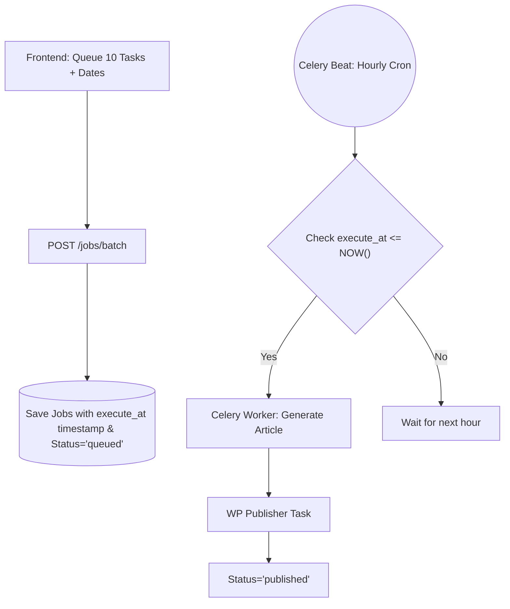
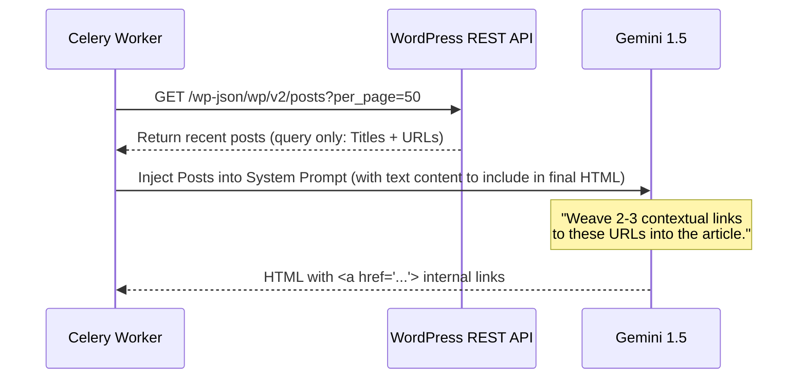
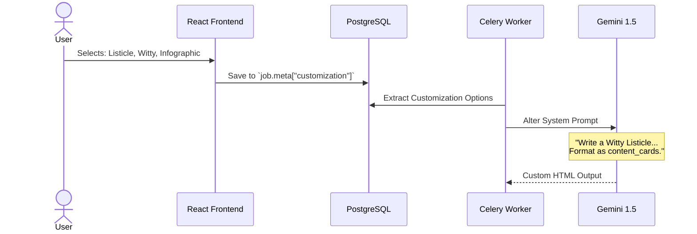

# NOT DONE
# 🚀 Auto-Blog SaaS: Advanced Feature Blueprint (Phase 3)

This document serves as the technical specification and architectural blueprint for the Coder LLM to implement the next major features for the Auto-Blog platform. It is broken down into three high-impact tiers.

---

## 🥇 Tier 1: SEO & Publishing Power
These features elevate the platform by fully automating the publishing lifecycle and maximizing SEO value through contextual linking.

### 1. Scheduled Execution (Drip-Feed) [did with claude but not confirmed]
**Goal:** Allow users to queue up to 10 tasks (keywords or reference links) with assigned execution dates. The system waits until the date arrives, then generates and publishes the article.

**Implementation Notes:**
- Add `execute_at` (DateTime) to the `Job` model (rather than `Article` model).
- Add validation to limit batch submissions to a maximum of 10 tasks.
- Setup Celery Beat in `celery_app.py` with an hourly `crontab`.
- Create a new Celery task `process_scheduled_jobs` that queries the DB for `queued` jobs where `execute_at <= NOW()` and dispatches the generation pipeline.

### 2. Smart Internal Linking Engine [did with claude but not confirmed]
**Goal:** The AI should automatically weave links to the user's older WordPress posts into the new article in matched keyword.

---

## 🥈 Tier 2: Workflow Automation
Features designed to make the platform "sticky" by putting content generation on autopilot.

### 3. Auto-Pilot Competitor Monitoring
**Goal:** Automatically rewrite competitor content the moment they publish a new blog post via RSS.

---

## 🥉 Tier 3: Quality & Customization [did with claude but not confirmed]
Granular controls over the AI output to cater to high-end B2B users.

### 5. Granular Content Controls
**Goal:** Let users define the exact shape, structure, and tone of the output.

**The Customization Matrix (All fields fallback to `default`)**
| Field | Default Value | Available Options | Applies To |
| :--- | :--- | :--- | :--- |
| `article_type` | `informational` | `informational`, `educational`, `guide`, `course module`, `listicle` | Gemini (Depth) |
| `article_structure` | `standard` | `standard`, `content_cards`, `q_and_a`, `step_by_step` | Gemini (HTML) |
| `image_style` | `standard` | `standard`, `ultra_realistic`, `minimalist`, `infographic` | Imagen (Prompt) |
| `tone_of_voice` | `professional` | `professional`, `conversational`, `witty`, `academic` | Gemini (Copy) |

